<!-- ═══════════════════════ 心臓を捧げよ ═══════════════════════ -->
<!--        Attack on Titan themed profile · Scout Regiment          -->
<!-- ══════════════════════════════════════════════════════════════ -->

<div align="center">



<a href="https://github.com/2ViShAlv1">
  
</a>

<br/>

<a href="https://linkedin.com/in/vishal-verma-6a99a5328"></a>
<a href="mailto:vishalverma210905@gmail.com"></a>


</div>


<!-- ═══════════════════════ DOSSIER ═══════════════════════ -->

## ⚔️ &nbsp;Soldier Dossier <sub>&nbsp;// about me</sub>

```python
class ScoutRegimentSoldier:
    """Survey Corps · AI/ML Division · stationed at Wall Rose HQ."""

    def __init__(self):
        self.name       = "Vishal Verma"
        self.rank       = "AI/ML Intern @ Hughes Systique"
        self.training   = "B.Tech CSE (AI/ML) @ BML Munjal University, '28"
        self.base       = "Gurugram, India"
        self.odm_gear   = ["Deep Learning", "Computer Vision", "MLOps"]
        self.blades     = ["Python", "Java", "C", "JavaScript"]
        self.oath       = "心臓を捧げよ — Shinzou wo Sasageyo!"
        self.beyond_the_walls = "Building intelligent systems for space tech 🛰️"

    def current_expedition(self):
        return {
            "building"  : "End-to-end ML pipelines in production",
            "learning"  : "Agentic AI systems & advanced DSA in Java",
            "exploring" : "Satellite imagery + remote sensing with DL",
        }
```

<table>
<tr>
<td width="24%" align="center" valign="middle">



<sub><b>WINGS OF FREEDOM</b></sub>

</td>
<td width="38%" valign="top">

**🗡️ Current Expedition** <sub>// working on</sub>
- End-to-end ML model development & deployment
- AI middleware routing NL prompts to microservices
- Two-stage CV pipelines for quality assessment

</td>
<td width="38%" valign="top">

**📜 Training Corps** <sub>// learning</sub>
- Agentic AI & LLM orchestration
- Data Structures & Algorithms in Java
- MLOps: experiment tracking, model registries

</td>
</tr>
</table>


<!-- ═══════════════════════ ARSENAL ═══════════════════════ -->

## 🛡️ &nbsp;ODM Gear & Arsenal <sub>&nbsp;// tech stack</sub>

<div align="center">

<sub><b>⚔️ &nbsp;BLADES · LANGUAGES</b></sub>


<sub><b>🔥 &nbsp;THUNDER SPEARS · ML / DEEP LEARNING</b></sub>


<br/>


<sub><b>🏰 &nbsp;FORTIFICATIONS · FRAMEWORKS & WEB</b></sub>


<br/>


<sub><b>🐎 &nbsp;SUPPLY LINES · DATABASES & TOOLS</b></sub>


</div>


<!-- ═══════════════════════ EXPEDITIONS ═══════════════════════ -->

## 🏰 &nbsp;Expeditions Beyond the Walls <sub>&nbsp;// projects</sub>

### <kbd>EXPEDITION 01</kbd> &nbsp;🔥 [Thermal-Sight](https://github.com/2ViShAlv1/Thermal-Sight) — Fire or Factory?

> *Mission brief:* Satellite thermal anomaly classification for Smart India Hackathon 2026 (SIH 26162). Separates industrial heat from forest fires and crop-residue burning across a year of NASA FIRMS VIIRS thermal detections — using DBSCAN clustering, temporal-persistence features, a rule engine, XGBoost, and a vision-language model as fallback for whatever the rules can't resolve.

| ⚔️ Field Report | |
|---|---|
| **Volume reduction** | **88,434** raw detections → **238** industrial sites to inspect (**99.73%** reduction) |
| **Region hold-out** | **0.914** macro-F1 — trained on 4 regions, tested on an unseen 5th |
| **Gold-set accuracy** | **86.8%** against 159 hand-labelled sources |
| **Interfaces** | React + FastAPI + Leaflet dashboard, and a Streamlit dashboard, both reading the same committed outputs |
| **Gear** | `Python` `FastAPI` `React` `XGBoost` `DBSCAN` `Gemini VLM` |

<br/>

### <kbd>EXPEDITION 02</kbd> &nbsp;🛡️ [StartupShield AI](https://github.com/2ViShAlv1/StartUpShield) — Explainable Startup Risk Scoring

> *Mission brief:* A risk-monitoring dashboard that turns customer, review, and revenue data into a single 0–100 company risk score — with a plain-language reason and a prioritized recommendation, not just a number. Combines churn prediction, sentiment analysis, anomaly detection, and forecasting behind a transparent, weighted (not black-box) risk formula.

| ⚔️ Field Report | |
|---|---|
| **Churn (LightGBM)** | **0.85** ROC-AUC, with SHAP-based per-customer explanations |
| **Anomaly detection** | **5/5** injected anomalies recovered (IsolationForest) |
| **Forecast** | Beats a naive baseline on **3/3** demo companies (Prophet) |
| **Live demo** | [startupshield.streamlit.app](https://startupshield.streamlit.app/) |
| **Gear** | `Python` `LightGBM` `Streamlit` `FastAPI` `React` `Prophet` `SHAP` |

<br/>

### <kbd>EXPEDITION 03</kbd> &nbsp;🍎 FreshVision AI — Fruit & Vegetable Quality Assessment

> *Mission brief:* A two-stage deep learning pipeline for automated produce grading.

| ⚔️ Field Report | |
|---|---|
| **Stage 1** | MobileNetV2 identifier — **97.8%** validation accuracy across 14 classes |
| **Stage 2** | 5-level freshness grader — **83.7%** validation accuracy |
| **Data** | ~30,000 images, HSV-based pseudo-labeling to generate freshness labels |
| **Serving** | Flask backend + Streamlit frontend for real-time inference |
| **Gear** | `Python` `TensorFlow` `Keras` `MobileNetV2` `OpenCV` `Flask` `Streamlit` |

<sub>📜 Academic thesis project · Co-authored with Harshul Saini · Supervised by Dr. Aurobindo Behera</sub>


<!-- ═══════════════════════ TERRITORY ═══════════════════════ -->

## 🗺️ &nbsp;Territory Reclaimed <sub>&nbsp;// open source repositories</sub>

<table>
<tr>
<td width="50%" valign="top">

#### [🧹 Data Cleaning using Python](https://github.com/2ViShAlv1/Data-Cleaning-using-Python)
Practical notebook walkthrough of real-world data cleaning — missing values, type coercion, outliers, and normalization.

`Jupyter` `Pandas` `NumPy`

</td>
<td width="50%" valign="top">

#### [📰 News Fetcher](https://github.com/2ViShAlv1/News-Fetcher-using-Python---NewsAPI)
Python client that pulls and filters live headlines through the NewsAPI, with query and source-level control.

`Python` `REST API`

</td>
</tr>
<tr>
<td width="50%" valign="top">

#### [🧩 Sudoku Solver](https://github.com/2ViShAlv1/Suduko-Solver)
Backtracking constraint-satisfaction solver in Java that handles any valid 9×9 grid.

`Java` `Backtracking` `Algorithms`

</td>
<td width="50%" valign="top">

#### [💧 Smart Water Leakage Detection](https://github.com/2ViShAlv1/Smart-Water-Leakage-Detection-System)
Embedded sensing system that flags anomalous flow patterns to catch leaks early.

`C++` `Embedded` `Sensors`

</td>
</tr>
<tr>
<td width="50%" valign="top">

#### [🏍️ IronRide](https://github.com/2ViShAlv1/IronRide)
Full-stack web application built with a JavaScript frontend and interactive UI.

`JavaScript` `HTML` `CSS`

</td>
<td width="50%" valign="top">

#### [📄 PDF Merger](https://github.com/2ViShAlv1/PDF-Merger)
Lightweight CLI utility to merge multiple PDF files into a single document using PyPDF2.

`Python` `PyPDF2`

</td>
</tr>
</table>

<div align="center">
  <a href="https://github.com/2ViShAlv1?tab=repositories">
    
  </a>
</div>


<!-- ═══════════════════════ SERVICE RECORD ═══════════════════════ -->

## 🎖️ &nbsp;Service Record <sub>&nbsp;// experience</sub>

**🏢 Hughes Systique Pvt. Ltd.** — *AI/ML Intern* &nbsp;·&nbsp; `May 2025 – Jul 2026`
> End-to-end ML model development, data preprocessing, feature engineering, and evaluation in a production environment. Collaborating cross-functionally to integrate AI-driven solutions into real systems, with hands-on exposure to MLOps workflows.

**🎓 Internshala** — *Student Partner* &nbsp;·&nbsp; `Apr 2026`
> Promoted internship opportunities and skill development programs across campus.

**🛰️ Agnirva Space Internship Program** — *Space Technology Intern* &nbsp;·&nbsp; `Aug 2025`
> Explored satellite systems, remote sensing, orbital mechanics, and space mission design. Studied earth observation and communication satellite architectures.


<!-- ═══════════════════════ KILL COUNT ═══════════════════════ -->

## 📊 &nbsp;Titan Kill Count <sub>&nbsp;// github analytics</sub>

<div align="center">


<br/>


<br/><br/>


</div>

<br/>

<!-- ═══════════════════════ SNAKE ═══════════════════════ -->

<div align="center">
  
  <br/>
  <sub><i>🐍 A Titan has breached the contribution wall…</i></sub>
</div>


<!-- ═══════════════════════ INSIGNIA ═══════════════════════ -->

## 🏅 &nbsp;Insignia Earned <sub>&nbsp;// certifications</sub>

- **Python (Basic)** — HackerRank · `326AD1CE7806`
- **The Ultimate Job Ready Data Science Course** — CodeWithHarry

<br/>

<!-- ═══════════════════════ FOOTER ═══════════════════════ -->

<div align="center">

### 🕊️ Join the Survey Corps <sub>// let's connect</sub>

<a href="https://linkedin.com/in/vishal-verma-6a99a5328"></a>
<a href="mailto:vishalverma210905@gmail.com"></a>

<br/><br/>

<i>"Someone who can't sacrifice anything can never change anything."</i><br/>
<sub>— Armin Arlert</sub>

<br/>

<sub><b>心臓を捧げよ</b> · TATAKAE · KEEP MOVING FORWARD</sub>


</div>
